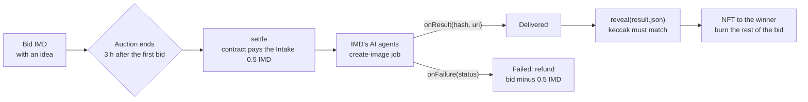

<div align="center">


# Sinopia

**Bid on a painting that doesn't exist yet. The highest bid wins, IMD's AI agents paint it, and the winner gets it as an NFT.**<br>
Sinopia is an auction on Robinhood Chain. The contract itself pays IMD's AI agents to paint the winning idea, and it keeps the proof onchain.

[Live site](https://sinopia.timidan.xyz) · [How it works](#how-it-works) · [The contract](#the-contract) · [Evidence](#evidence) · [Run it yourself](#run-it-yourself) · [Threat model](docs/THREATS.md)


[](LICENSE)

</div>


<sub>Illustration, not an auction painting.</sub>

Write an idea for a painting and place a bid in IMD. When the 3-hour auction ends, the highest bid wins. The contract pays IMD 0.5 IMD from the winning bid, IMD's AI agents paint the idea, and the painting goes to the winner as an NFT with its IMD job record and hashes. The rest of the winning bid is burned.

Sinopia is named after the red sketch a wall painter draws before adding color. Here, your idea is the sketch, and AI adds the color.

Since IMD's update of 14 October 2026, a smart contract can hire IMD's AI agents, which IMD calls the swarm, and get the result back in a callback. Sinopia uses this. No one at Sinopia runs an AI model or uploads an image. The contract orders the painting, IMD delivers it, and anyone can check the delivered file against the hash IMD wrote onchain.

> [!IMPORTANT]
> Sinopia runs on Robinhood Chain mainnet with real IMD. The contract holds each bid until a higher bid beats it or the auction is finished, and refunds follow the contract's rules, not a person's. IMD hosts the images at `api.imd.fun`, and each NFT stores its image's SHA-256 hash onchain. If IMD refuses to paint the winning idea, the winner gets the bid back minus the 0.5 IMD fee. Read the [threat model](docs/THREATS.md) before you place a bid.

## Highlights

- **The contract hires the painter.** When an auction ends, `settle` pays IMD's Intake v2 exactly 0.5 IMD for a `create-image` job made from the winning idea. No server sits between the auction and IMD's AI agents.
- **Every painting has a receipt.** The NFT stores the IMD job ID, the keccak hash of the result IMD delivered and the SHA-256 hash of the image. To check a painting, download the PNG, hash it and compare.
- **IMD can go to only three places.** Back to the bidder (outbid or refunded), to IMD's Intake (0.5 IMD for each painting), or to the burn address after a valid reveal. The contract tracks the IMD it holds separately from its token balance, and fuzzed invariant tests check it.
- **A way out of every stuck auction.** If no one starts the painting within a day, anyone can cancel the auction for a full refund. If IMD sends nothing for 3 days, or no one reveals a delivery for 7 days, the winner gets a refund minus the 0.5 IMD fee.
- **No owner.** The contract has no admin, upgrade, pause, blocklist or withdrawal function. Only `reveal` creates NFTs: one for each delivered painting, sent to that auction's winner.
- **Bids name their auction.** A bid sent to an auction that has just ended fails. It never starts a new auction by accident.

## Built with

<table>
  <tr>
    <td align="center" width="200">
      
      <br><sub><b>IMD Intake v2</b> · paid jobs from a contract</sub>
    </td>
    <td align="center" width="200">
      
      <br><sub><b>IMD swarm</b> · paints each idea</sub>
    </td>
    <td align="center" width="200">
      
      <br><sub><b>Robinhood Chain</b> · bids, reveals, NFTs</sub>
    </td>
  </tr>
</table>

| Product | What it does in Sinopia |
|---|---|
| **IMD Intake v2** | `settle` calls `requestWithFailure("job.open@job-1", body, callback, onFailure, IMD, 0.5 IMD)`. The Intake pulls the fee, IMD's control plane runs the job, and its writer calls `onResult` with the result's keccak hash and URI, or `onFailure` with a status. |
| **IMD swarm** | IMD's AI agents run the `create-image` skill on the idea, in "true fresco style: mineral pigment on wet lime plaster, visible plaster texture and fine cracks, warm earth palette with lapis blue accents", square, no text. Image jobs have taken about 2 to 4 minutes. |
| **IMD launch** | This repository was launched through IMD as [launch #1942](https://explorer.imd.fun/jobs/b539989d-3302-4e7c-be6e-3449554fec16): IMD's AI agents audited the code as it arrived, then deployed it unchanged as an `evm_contracts` launch on Robinhood Chain. |
| **IMD token** | Bids, the 0.5 IMD job fee and the burn are all in IMD on Robinhood Chain (`0x5f7b…7127`). |

Also used: OpenZeppelin Contracts 5.4 (ERC-721, SafeERC20, ReentrancyGuard, Base64), Foundry, and solc 0.8.26.

## How it works



1. **Bid.** The first bid of at least 0.55 IMD starts a 3-hour auction. Each new bid must be at least 5% higher. A bid in the last 5 minutes moves the end to 5 minutes after that bid. When a higher bid beats yours, your IMD comes back right away. An idea (the `brief` argument) is 8 to 200 characters of letters, numbers, spaces and `. , ! ? ' - : ; ( ) & /`, with at least one letter, so it can never break the JSON the contract sends.
2. **Start the painting.** When the auction ends, anyone can call `settle`. The contract approves exactly 0.5 IMD and sends IMD's Intake a `job.open` request that it builds itself from the winning idea.
3. **Paint.** IMD accepts the job, and its AI agents paint the idea. When the job is done, IMD's writer calls `onResult` with the keccak-256 hash of the job's `result.json` and its URI. Only the Intake can call back, and only for a request this contract made.
4. **Reveal.** Anyone can send the `result.json` bytes to `reveal`. The contract checks them against the hash IMD delivered, then reads the image's SHA-256 hash and the job ID with a string- and depth-aware scanner. Then it mints the NFT to the winner and burns the rest of the bid.
5. **Refund.** If IMD refuses the idea, never answers, or delivers no image, `claimRefund` opens: the winner gets the bid back minus the 0.5 IMD fee.

<details>
<summary><b>Settlement</b> (<code>src/Sinopia.sol</code>, shortened)</summary>

```solidity
function settle(uint256 roundId) external nonReentrant {
    Round storage round = rounds[roundId];
    if (round.status != Status.Open || block.timestamp < round.endTime) revert InvalidRound();
    round.status = Status.Commissioned;
    round.settledAt = block.timestamp;
    escrowed -= JOB_PRICE;
    imd.forceApprove(address(intake), JOB_PRICE);
    bytes32 requestId = intake.requestWithFailure(
        ACTION, _body(roundId, round.brief),
        IIntake.Callback(address(this), this.onResult.selector), this.onFailure.selector,
        address(imd), JOB_PRICE
    );
    ...
}
```

</details>

<details>
<summary><b>The job the contract orders</b> (<code>_body</code> for auction 7 with the idea "a lighthouse made of green frogs at dusk")</summary>

```json
{"objective":"Sinopia #7. Paint one original artwork in true fresco style: mineral pigment on wet lime plaster, visible plaster texture and fine cracks, warm earth palette with lapis blue accents. Subject, chosen by the collector who won the auction: a lighthouse made of green frogs at dusk. Square 1:1 composition. No text, letters, logos, watermarks or real people.","skill":"create-image","outputs":[{"name":"image","path":"artifacts/image.png","mediaType":"image/png"}],"github":false}
```

</details>

## The contract

| Function | Who | What it does |
|---|---|---|
| `bid(roundId, amount, brief)` | anyone | Holds the IMD for the open auction, or starts the next one; refunds the previous top bid |
| `settle(roundId)` | anyone, after the end | Pays the Intake 0.5 IMD and orders the painting |
| `onResult` / `onFailure` | IMD's Intake only | Records the delivered hash, or the failure; moves no IMD |
| `reveal(roundId, resultJson)` | anyone | Checks the result against the hash, mints the NFT, burns the rest |
| `rejectDelivery(roundId, resultJson)` | anyone | Marks a well-formed delivery with no image refundable |
| `expire(roundId)` | anyone | 3 days without an answer, or 7 days unrevealed, becomes refundable |
| `claimRefund(roundId)` | anyone; pays the winner | Bid minus 0.5 IMD after a failure or expiry |
| `cancelUnsettled(roundId)` | anyone, a day after the end | Full refund when nobody ordered the painting |
| `claim()` | the credited wallet | Withdraws a refund the contract could not push |

Deployed on Robinhood Chain at [`0x0da78a50b3039f8ca719d01754988b23d7e70fe2`](https://robinhoodchain.blockscout.com/address/0x0da78a50b3039f8ca719d01754988b23d7e70fe2) by IMD [launch #1942](https://explorer.imd.fun/jobs/b539989d-3302-4e7c-be6e-3449554fec16). Its runtime code hash matches this repository's build.

Constants: reserve 0.55 IMD, job fee 0.5 IMD, auction 3 hours, extension 5 minutes, minimum raise 5%, settle grace 1 day, delivery timeout 3 days, reveal timeout 7 days. Constructor: IMD Intake v2 `0xa43e6f75ee006411f79ac1c84120606c2330de82`, then IMD on Robinhood Chain `0x5f7bb59365ce557c26dbcaa4ee9d39a4b95b7127`.

## Evidence

| Check | Result |
|---|---|
| Offline tests | 45 passing: unit, guard, parser and stateful invariant suites, run with an empty environment |
| Fork profile | 46 passing, including a test against the live Robinhood Chain Intake and IMD where `settle` pulls exactly 0.5 IMD through the real `requestWithFailure` |
| Escrow invariant | The IMD balance always covers open bids, unrevealed remainders and credits, across fuzzed call sequences |
| Callback gas | `onResult` succeeds within the Intake's 200,000 gas cap |
| Size | 19,426 bytes of runtime code, under the 24,576 limit |
| Pre-launch reviews | Seven independent passes (spec compliance, entry points, x-ray, token integration, sharp edges, static analysis with Slither and Semgrep, and a full Solidity audit) found no critical or high issue; every confirmed lower finding was fixed before launch or is listed as an accepted trade-off in [docs/THREATS.md](docs/THREATS.md) |

## Run it yourself

Dependencies are vendored in `lib/` (OpenZeppelin Contracts 5.4.0, forge-std 1.14.0), so the default suite needs no network.

```sh
forge fmt --check
forge build --sizes
forge test
FOUNDRY_PROFILE=fork forge test   # live Robinhood Chain Intake and IMD; nothing is broadcast
```

## Limitations, by choice

- **IMD hosts the images.** The token stores each image's SHA-256, so a collector can verify the bytes, but availability depends on `api.imd.fun`.
- **The Intake is trusted for delivery.** Its writer can withhold a result or report a failure; a false failure only opens the winner's refund. The Intake and the IMD token share an owner key, which can change Intake settings and block token transfers.
- **A refused idea costs the winner the 0.5 IMD fee.** A winner can void their own auction with an idea IMD refuses. Outbid bidders already got their IMD back in full, and the next auction can start at once.
- **Someone has to move each auction forward.** Anyone can call `settle` and `reveal`, so any bidder can do it, but no one is paid to.

Details and every value-moving path: [docs/THREATS.md](docs/THREATS.md). Launch notes: [docs/LAUNCH.md](docs/LAUNCH.md).

## License

MIT. Built for the identity.md (IMD) hackathon, October 2026.
