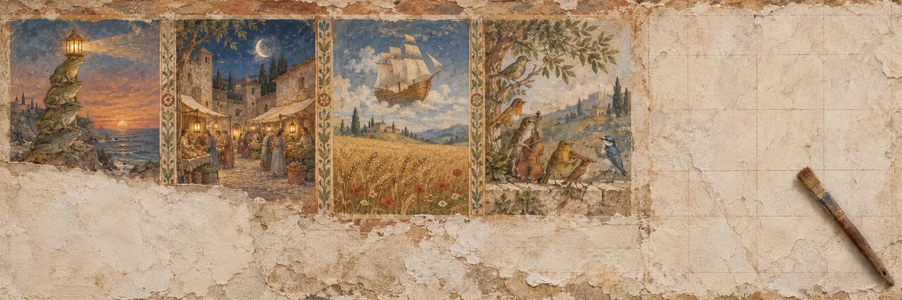
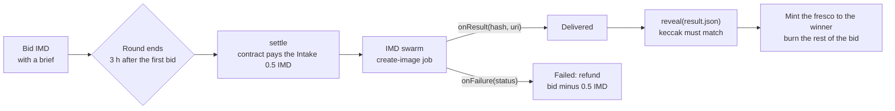

<div align="center">


# Sinopia

**Sinopia is an onchain auction where each winning bid commissions the IMD swarm to paint the winner's brief, and the finished fresco is minted to the winner.**<br>
You write the sinopia, the sketch on the plaster. The swarm paints the fresco. The contract hires the painter itself and keeps the receipt.

[How it works](#how-it-works) · [The contract](#the-contract) · [Evidence](#evidence) · [Run it yourself](#run-it-yourself) · [Threat model](docs/THREATS.md)


[](LICENSE)

</div>



A fresco painter first sketches the composition on the wet plaster in red-brown earth. That sketch is the sinopia. Here, the sketch is yours: bid IMD with a short brief, and when the round ends the highest bid wins. The contract then pays IMD's agent swarm 0.5 IMD to paint the winning brief as a fresco, takes the result back onchain, and mints the painting to the winner with its job record and hashes. The rest of the winning bid is burned.

Since IMD's protocol update of 14 October 2026, a smart contract can open any swarm job and receive the result in a callback. Sinopia is a customer of that swarm: nobody at Sinopia runs a model or uploads an image. The contract places the order, the swarm delivers, and anyone can check the delivery against the hash IMD wrote onchain.

> [!IMPORTANT]
> Sinopia runs on Robinhood Chain mainnet with real IMD. A bid stays escrowed until it is outbid or its round resolves, and refunds follow the contract's rules, not a person's. Images are served by IMD at `api.imd.fun`, addressed by their SHA-256, which the NFT stores onchain. A winner whose brief IMD refuses gets the bid back minus the 0.5 IMD job fee. Read the [threat model](docs/THREATS.md) before you bid.

## Highlights

- **The contract is the customer.** `settle` pays IMD's Intake v2 exactly 0.5 IMD for a `create-image` job built from the winning brief. No server sits between the auction and the swarm.
- **Every fresco has a receipt.** The NFT stores the IMD job id, the keccak hash of the result IMD delivered and the SHA-256 of the image. Download the PNG, hash it, compare.
- **IMD can only go three places.** Back to the bidder (outbid or refunded), to IMD's Intake (0.5 IMD per settled round), or to the burn address after a valid reveal. Escrow is tracked separately from the token balance and held under fuzzed invariant tests.
- **A way out of every stuck state.** A round nobody settles can be cancelled after a day for a full refund. A job with no answer for 3 days, or a delivery nobody reveals for 7, refunds the winner minus the job fee.
- **No owner.** No admin, upgrade, pause, blocklist or withdrawal function exists. NFTs are created only by `reveal`, one per delivered commission, to that round's winner.
- **Bids name their round.** A bid aimed at a round that has just ended reverts instead of quietly opening a new one.

## Built with

<table>
  <tr>
    <td align="center" width="200">
      
      <br><sub><b>IMD Intake v2</b> · paid jobs from a contract</sub>
    </td>
    <td align="center" width="200">
      
      <br><sub><b>IMD swarm</b> · paints each brief</sub>
    </td>
    <td align="center" width="200">
      
      <br><sub><b>Robinhood Chain</b> · bids, reveals, NFTs</sub>
    </td>
  </tr>
</table>

| Product | What it does in Sinopia |
|---|---|
| **IMD Intake v2** | `settle` calls `requestWithFailure("job.open@job-1", body, callback, onFailure, IMD, 0.5 IMD)`. The Intake pulls the fee, IMD's control plane runs the job, and its writer calls `onResult` with the result's keccak hash and URI, or `onFailure` with a status. |
| **IMD swarm** | Runs the `create-image` skill on the brief, in "true fresco style: mineral pigment on wet lime plaster, visible plaster texture and fine cracks, warm earth palette with lapis blue accents", square, no text. Image jobs have taken about 2 to 4 minutes. |
| **IMD launch** | This repository launches through the IMD protocol: IMD's agents audit the code as it arrived, then deploy it as an `evm_contracts` launch on Robinhood Chain. |
| **IMD token** | Bids, the 0.5 IMD job fee and the burn are all in IMD on Robinhood Chain (`0x5f7b…7127`). |

Also used: OpenZeppelin Contracts 5.4 (ERC-721, SafeERC20, ReentrancyGuard, Base64), Foundry, and solc 0.8.26.

## How it works



1. **Bid.** The first bid of at least 0.55 IMD opens a 3-hour round. Each new bid must be at least 5% higher, and a bid in the last 5 minutes moves the end to 5 minutes from now. Outbid IMD goes straight back. A brief is 8 to 200 characters of letters, digits, spaces and `. , ! ? ' - : ; ( ) & /`, with at least one letter, so it can never break the JSON the contract sends.
2. **Settle.** Once the round ends, anyone can call `settle`. The contract approves exactly 0.5 IMD and sends IMD's Intake a `job.open` body it builds itself from the winning brief.
3. **Paint.** IMD's control plane admits the job and the swarm paints it. When the job completes, IMD's writer calls `onResult` with the keccak-256 of the job's `result.json` and its URI. Only the Intake may call back, and only for a request this contract made.
4. **Reveal.** Anyone submits the `result.json` bytes. The contract checks them against the hash IMD delivered, reads the image's SHA-256 and the job id with a string- and depth-aware scanner, mints the NFT to the winner, and burns the rest of the bid.
5. **Refund.** A refusal, a job that never answers, or a delivery with no image opens `claimRefund`: the winner gets the bid back minus the 0.5 IMD the swarm charged.

<details>
<summary><b>Settlement</b> (<code>src/Sinopia.sol</code>, shortened)</summary>

```solidity
function settle(uint256 roundId) external nonReentrant {
    Round storage round = rounds[roundId];
    if (round.status != Status.Open || block.timestamp < round.endTime) revert InvalidRound();
    round.status = Status.Commissioned;
    round.settledAt = block.timestamp;
    escrowed -= JOB_PRICE;
    imd.forceApprove(address(intake), JOB_PRICE);
    bytes32 requestId = intake.requestWithFailure(
        ACTION, _body(roundId, round.brief),
        IIntake.Callback(address(this), this.onResult.selector), this.onFailure.selector,
        address(imd), JOB_PRICE
    );
    ...
}
```

</details>

<details>
<summary><b>The job the contract orders</b> (<code>_body</code> for round 7 with the brief "a lighthouse made of green frogs at dusk")</summary>

```json
{"objective":"Sinopia #7. Paint one original artwork in true fresco style: mineral pigment on wet lime plaster, visible plaster texture and fine cracks, warm earth palette with lapis blue accents. Subject, chosen by the collector who won the auction: a lighthouse made of green frogs at dusk. Square 1:1 composition. No text, letters, logos, watermarks or real people.","skill":"create-image","outputs":[{"name":"image","path":"artifacts/image.png","mediaType":"image/png"}],"github":false}
```

</details>

## The contract

| Function | Who | What it does |
|---|---|---|
| `bid(roundId, amount, brief)` | anyone | Escrows IMD on the open round, or opens the next one; refunds the previous top bid |
| `settle(roundId)` | anyone, after the end | Pays the Intake 0.5 IMD and orders the painting |
| `onResult` / `onFailure` | IMD's Intake only | Records the delivered hash, or the failure; moves no IMD |
| `reveal(roundId, resultJson)` | anyone | Checks the result against the hash, mints the NFT, burns the rest |
| `rejectDelivery(roundId, resultJson)` | anyone | Marks a well-formed delivery with no image refundable |
| `expire(roundId)` | anyone | 3 days without an answer, or 7 days unrevealed, becomes refundable |
| `claimRefund(roundId)` | anyone; pays the winner | Bid minus 0.5 IMD after a failure or expiry |
| `cancelUnsettled(roundId)` | anyone, a day after the end | Full refund when nobody ordered the painting |
| `claim()` | the credited wallet | Withdraws a refund the contract could not push |

Constants: reserve 0.55 IMD, job fee 0.5 IMD, round 3 hours, extension 5 minutes, minimum raise 5%, settle grace 1 day, delivery timeout 3 days, reveal timeout 7 days. Constructor: IMD Intake v2 `0xa43e6f75ee006411f79ac1c84120606c2330de82`, then IMD on Robinhood Chain `0x5f7bb59365ce557c26dbcaa4ee9d39a4b95b7127`.

## Evidence

| Check | Result |
|---|---|
| Offline tests | 45 passing: unit, guard, parser and stateful invariant suites, run with an empty environment |
| Fork profile | 46 passing, including a test against the live Robinhood Chain Intake and IMD where `settle` pulls exactly 0.5 IMD through the real `requestWithFailure` |
| Escrow invariant | The IMD balance always covers open bids, unrevealed remainders and credits, across fuzzed call sequences |
| Callback gas | `onResult` succeeds within the Intake's 200,000 gas cap |
| Size | 19,426 bytes of runtime code, under the 24,576 limit |
| Pre-launch reviews | Seven independent passes (spec compliance, entry points, x-ray, token integration, sharp edges, static analysis with Slither and Semgrep, and a full Solidity audit) found no critical or high issue; every confirmed lower finding was fixed before launch or is listed as an accepted trade-off in [docs/THREATS.md](docs/THREATS.md) |

## Run it yourself

Dependencies are vendored in `lib/` (OpenZeppelin Contracts 5.4.0, forge-std 1.14.0), so the default suite needs no network.

```sh
forge fmt --check
forge build --sizes
forge test
FOUNDRY_PROFILE=fork forge test   # live Robinhood Chain Intake and IMD; nothing is broadcast
```

## Limitations, by choice

- **IMD hosts the images.** The token stores each image's SHA-256, so a collector can verify the bytes, but availability depends on `api.imd.fun`.
- **The Intake is trusted for delivery.** Its writer can withhold a result or report a failure; a false failure only opens the winner's refund. The Intake and the IMD token share an owner key, which can change Intake settings and block token transfers.
- **A refused brief costs the winner the job fee.** A winner can void their own round with a brief IMD refuses; outbid bidders were refunded in full and the next round opens at once.
- **Someone has to move each round.** `settle` and `reveal` are open to anyone, so any bidder can move a round forward; nobody is paid to do it.

Details and every value-moving path: [docs/THREATS.md](docs/THREATS.md). Launch notes: [docs/LAUNCH.md](docs/LAUNCH.md).

## License

MIT. Built for the identity.md (IMD) hackathon, October 2026.
